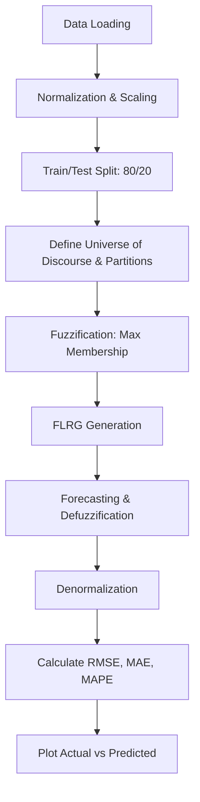

# 🌫️ Fuzzy Time Series Forecasting

[](https://www.python.org/downloads/)
[](https://opensource.org/licenses/MIT)

An implementation of First-Order (FOFTS) and High-Order (HOFTS) Fuzzy Time Series forecasting models, applied to the chaotic **Mackey-Glass** dataset and epidemiological **Influenza Specimens** data.

## 🏗 Architecture & Workflow



## 📊 Performance Metrics

Based on the experimental runs:

- **Mackey-Glass (HOFTS, Order = 2):** RMSE ≈ `0.0815`, MAE ≈ `0.0671`, MAPE ≈ `11.42%`.
- **Specimens TOTAL SPECIMENS (HOFTS, Order = 2):** RMSE ≈ `11571.74`, MAE ≈ `8656.28`, MAPE ≈ `11.77%`.
- **Specimens TOTAL B (HOFTS, Order = 2):** RMSE ≈ `828.44`, MAE ≈ `756.71`, MAPE ≈ `579.21%`.

For more detailed experimental results, see [`BENCHMARKS.md`](BENCHMARKS.md).

## 🚀 Quick Start

### Prerequisites

- Python 3.9+
- `pip` and `virtualenv`
- Dataset files (`mackey_glass.csv` and `Specimens.csv`) placed in the root directory.

### Installation & Execution

#### 1. Clone the Repository

```bash
git clone https://github.com/yourusername/fuzzy-time-series.git
cd fuzzy-time-series
```

#### 2. Create a Virtual Environment

```bash
python -m venv venv
```

Activate the environment:

**Linux/macOS:**

```bash
source venv/bin/activate
```

**Windows:**

```powershell
venv\Scripts\activate
```

#### 3. Install Dependencies

```bash
pip install -r requirements.txt
```

#### 4. Configure Environment Variables (Optional)

```bash
cp .env.example .env
```

On Windows Command Prompt:

```cmd
copy .env.example .env
```

#### 5. Run Mackey-Glass Forecasting

```bash
python src/mackey_glass.py
```

#### 6. Run Specimens Forecasting

Ensure `SPECIMENS_COLUMN` is configured in your `.env` file.

```bash
python src/specimens.py
```

## 📁 Project Structure

```text
fuzzy-time-series/
├── src/
│   ├── config.py           # Hyperparameters (Order, Partitions) and file paths
│   ├── metrics.py          # RMSE, MAE, MAPE calculations
│   ├── fts_core.py         # Membership functions, Fuzzification, FLRG, Forecast
│   ├── mackey_glass.py     # Runner for Mackey-Glass dataset
│   └── specimens.py        # Runner for Specimens dataset
├── results/                # Generated plots (git-ignored)
├── requirements.txt        # Python dependencies
├── BENCHMARKS.md           # Detailed experimental results
└── README.md
```

## 🔐 Security & Configuration

Hyperparameters and dataset paths are managed through environment variables. Create a `.env` file in the root directory:

```env
ORDER=2
PARTITIONS=8
TRAIN_SPLIT=0.8

MACKEY_GLASS_PATH=mackey_glass.csv
SPECIMENS_PATH=Specimens.csv
SPECIMENS_COLUMN="TOTAL SPECIMENS"
```

Make sure the column name in `SPECIMENS_COLUMN` exactly matches the column name in your CSV file.

## 🔮 Future Improvements

- **Adaptive Partitions:** Implement a clustering algorithm such as K-Means to determine optimal unequal-length intervals instead of using fixed, equal-length partitions.
- **Multivariate FTS:** Extend the model to accept multiple inputs simultaneously (e.g., using `TOTAL A` and `TOTAL B` to predict the next `TOTAL SPECIMENS` value).
- **Interactive Interface:** Build a Gradio or Streamlit dashboard where users can input `n` historical data points and receive the next predicted value in real time.